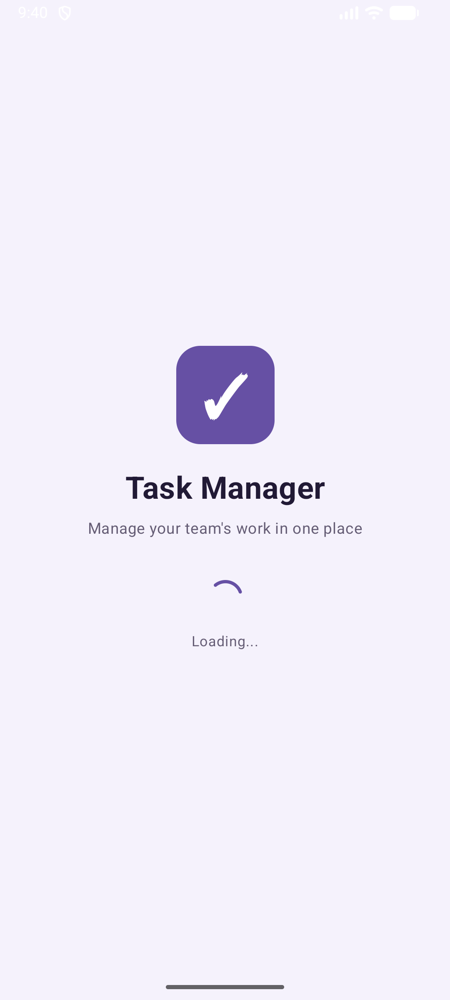
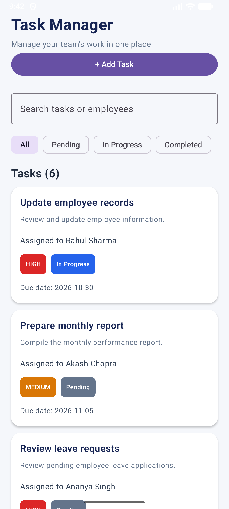
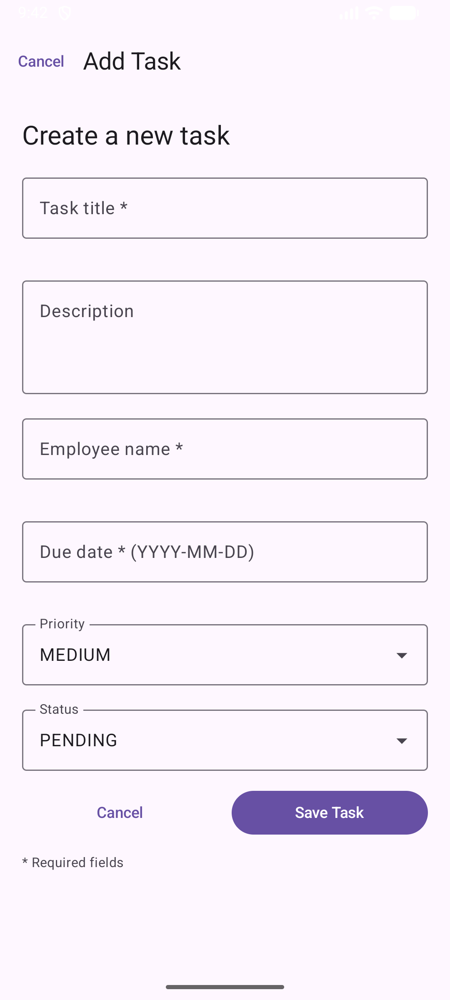
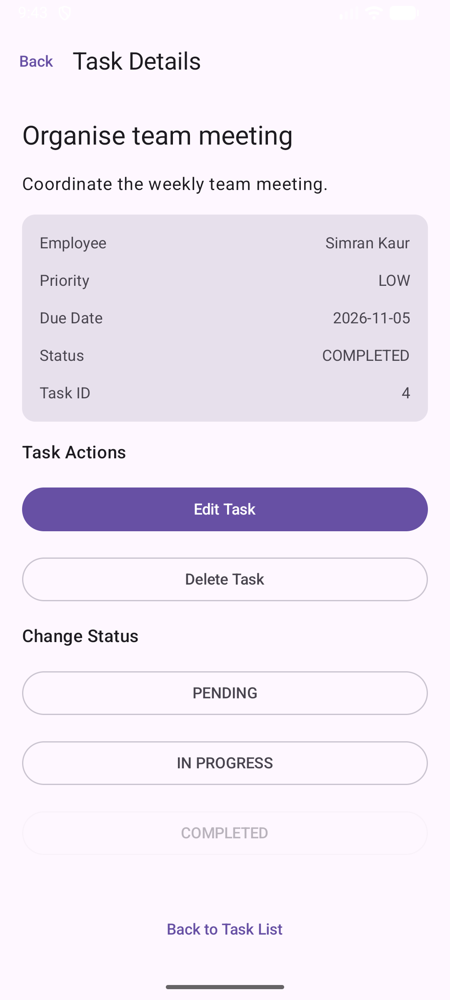
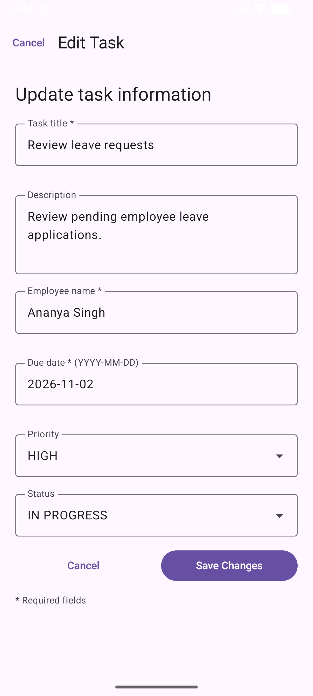

# Task Management Application

An Android-based Task Management Application developed using **Kotlin** and **Jetpack Compose**. The application allows users to create, view, update, delete, search, and manage employee tasks through a simple and user-friendly interface.

## Project Overview

The Task Management Application is designed to provide a basic interface for managing employee tasks. Users can view existing tasks' details, add new tasks, update task information, change task statuses, and delete tasks.

This application was developed as an Android Development Assignment, with a focus on implementing modern Android UI development practices using Kotlin and Jetpack Compose.

## Objectives

- Develop a functional Android Task Management Application.
- Provide a simple and consistent user interface.
- Implement task creation, viewing, editing, and deletion.
- Enable task searching and status-based filtering.
- Demonstrate navigation and state management using Jetpack Compose.

## Technologies Used

| Technology | Purpose |
|---|---|
| Kotlin | Primary programming language |
| Jetpack Compose | UI development |
| Android Studio | Development environment |
| Material Design 3 | UI components and styling |
| Gradle | Build automation |
| Android Emulator | Application testing |
| Git and GitHub | Version control and source code hosting |

## Features

### 1. Splash Screen
- Displays the application name and icon.
- Includes a loading indicator.
- Automatically navigates to the Task List screen.

### 2. Task List
- Displays six predefined sample tasks when the application starts.
- Shows task title, employee name, priority, due date, and status.
- Search tasks by title or employee name.
- Filter tasks by status.
- Navigate to Add Task and Task Details screens.
- Displays an appropriate empty state when no tasks match the search or filter.

### 3. Add Task
- Create new tasks.
- Enter title, description, employee name, due date, priority, and status.
- Validate required fields and date input.
- Display validation messages when input is invalid.

### 4. Task Details
- View complete task information.
- Navigate to the Edit Task screen.
- Change the task status.
- Delete tasks after confirmation.

### 5. Edit Task
- Edit existing task information.
- Displays previously saved task details in the form.
- Validates input before updating a task.
- Updates the task information in the Task List.

## Project Structure

The main application source code is organised into the following packages:

```text
TaskManagementApplication/
│
├── app/
│   └── src/
│       └── main/
│           ├── java/
│           │   └── com/example/taskmanagementapplication/
│           │       ├── data/
│           │       │   └── SampleTasks.kt
│           │       │
│           │       ├── model/
│           │       │   └── Task.kt
│           │       │
│           │       ├── state/
│           │       │   └── TaskStore.kt
│           │       │
│           │       ├── ui/
│           │       │   ├── AddTaskScreen.kt
│           │       │   ├── EditTaskScreen.kt
│           │       │   ├── TaskDetailsScreen.kt
│           │       │   ├── SplashScreen.kt
│           │       │   └── DateValidation.kt
│           │       │
│           │       ├── ui/theme/
│           │       │
│           │       └── MainActivity.kt
│           │
│           └── AndroidManifest.xml
│
├── gradle/
├── build.gradle.kts
├── settings.gradle.kts
├── gradle.properties
├── gradlew
├── gradlew.bat
└── README.md
```

## Getting Started

### Prerequisites

- Android Studio
- Android SDK
- Kotlin support
- Android Emulator or a compatible Android device

### Run the Project

1. Clone the repository:

   ```bash
   git clone https://github.com/ArnabRoy021/TaskManagementApplication.git
   ```

2. Open Android Studio.

3. Select **Open** and choose the cloned project folder.

4. Allow Android Studio to complete the Gradle sync.

5. Start an Android Emulator or connect an Android device.

6. Click the **Run** button in Android Studio to build and launch the application.

## Assumptions

- The application is designed as a front-end demonstration.
- Sample employee and task information is predefined.
- No real employee accounts or authentication are required or used.
- Task information is managed locally during the current application session.

## Data Storage and Application Limitations

- The application currently uses predefined sample task data.
- Task information is managed using an in-memory state store.
- No Backend API or external database is integrated.
- Newly added, edited, and deleted tasks are reflected during the current application session.
- Task changes are NOT permanently stored and will reset once the application process is restarted.

## Screenshots

### 1. Splash Screen


### 2. Task List


### 3. Add Task


### 4. Task Details


### 5. Edit Task


## Future Improvements

- Integrate a Backend API.
- Add persistent database storage.
- Implement user authentication.
- Add task notifications and reminders.
- Introduce additional task management and reporting features.

## AI Assistance Tools

ChatGPT and Gemini were used as AI assistance tools during development.

They supported the development process through:
- Technical guidance and explanations of Kotlin and Jetpack Compose.
- Assistance with understanding application structure and implementation.
- Troubleshooting build errors and development issues.
- Reviewing implementation approaches and explaining code functionality.

The application was implemented, integrated, and tested in Android Studio. 

## Repository

GitHub: https://github.com/ArnabRoy021/TaskManagementApplication

---

**Developed using Kotlin and Jetpack Compose.**